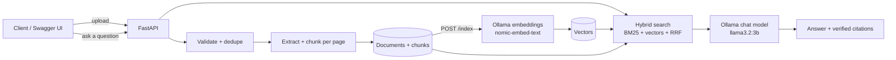

# Sovereign AI Workbench

A private, governed AI platform for confidential industrial work (SIH 2026, PS **SIH26117**).
Open-weight LLMs, document search (RAG) with source citations, governed agents, audit logs and
cost tracking - all running inside your own AWS network, so company data never leaves.

> Status: **Stage 2 of 7 - Search and cited answers (RAG)**.

## Roadmap
| Stage | What | Status |
|---|---|---|
| 1 | Backend API, document upload, text extraction, chunking | done |
| 2 | Local embeddings, hybrid search, RAG answers with verified citations | done |
| 3 | Agents and tools | next |
| 4 | Login, roles, audit log, cost tracking | |
| 5 | Web UI (liquid glass, responsive) | |
| 6 | Docker, Kubernetes, Terraform, CI/CD, AWS deploy | |
| 7 | Docs, architecture diagram, demo | |

## Architecture


## Run it
**1. Install Ollama** (the local AI engine) from https://ollama.com, then in a terminal:
```bash
ollama pull nomic-embed-text
ollama pull llama3.2:3b
```
**2. Start the backend (Python):**
```bash
cd backend
python -m venv .venv
# Windows:  .venv\Scripts\activate      Mac/Linux:  source .venv/bin/activate
pip install -r requirements-dev.txt
pytest -v
uvicorn app.main:app --reload
```
Open http://localhost:8000/docs. Check http://localhost:8000/health/ai to see if Ollama and both models are ready.

**Or with Docker:** `docker compose up --build` (Ollama still runs on your machine).

## Try it
1. `POST /api/v1/documents` - upload a PDF/DOCX/TXT/MD.
2. `POST /api/v1/index` - embed everything not yet indexed.
3. `POST /api/v1/search` - body `{"query": "your question"}` - best passages with page numbers.
4. `POST /api/v1/ask` - same body - a written answer with `[1]`-style citations that are verified.

## API
| Method | Path | Purpose |
|---|---|---|
| POST | `/api/v1/documents` | Upload a PDF, DOCX, TXT or MD file |
| GET | `/api/v1/documents?q=&limit=&offset=` | List / search documents |
| GET | `/api/v1/documents/{id}` | Document details |
| GET | `/api/v1/documents/{id}/chunks` | The text chunks of a document |
| DELETE | `/api/v1/documents/{id}` | Delete document, chunks, vectors and file |
| POST | `/api/v1/index` | Index all documents that are not indexed yet |
| POST | `/api/v1/documents/{id}/index` | Index one document |
| GET | `/api/v1/index/status` | How much is indexed, per document |
| POST | `/api/v1/search` | Hybrid search (meaning + keywords) |
| POST | `/api/v1/ask` | Cited answer from your documents |
| GET | `/health`, `/health/ready`, `/health/ai` | Liveness, database, Ollama + models |

## Design decisions (good interview answers)
- **Validate by content, not just extension** - a renamed `.exe` as `.pdf` is rejected.
- **SHA-256 dedupe** - the same file is never processed or stored twice (HTTP 409).
- **Chunks never cross pages** - every future answer can cite the exact page.
- **Storage behind an interface** - local disk today, S3 in stage 6, no router changes.
- **Atomic writes and rollback** - if the database save fails, the stored file is removed.
- **Request IDs and structured logs** - ready for CloudWatch.
- **Hybrid search (BM25 + vectors, merged with Reciprocal Rank Fusion)** - exact codes like "P-101" and
  differently-worded questions both work. If Ollama is down, search degrades to keywords instead of failing.
- **Citation verification** - the model may only cite sources it was given; invented `[9]`-style citations
  are removed and flagged. Answers with no citation are flagged too.
- **Prompt-injection guard** - document text is passed as data with explicit rules not to follow it.
- **Model-aware vectors** - each vector records the model that made it; changing the embedding model
  re-indexes cleanly instead of mixing incompatible vectors.
- **Graceful AI outages** - `/ask` returns the best passages even when the chat model is unavailable.
- **Known limit (by design for now)** - vectors are compared in memory (fine for thousands of chunks).
  Stage 6 moves this to pgvector with an index on Amazon RDS.
