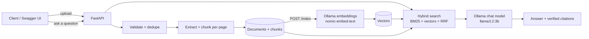

# Sovereign AI Workbench

A private, governed AI platform for confidential industrial work (SIH 2026, PS **SIH26117**).
Open-weight LLMs, document search (RAG) with source citations, governed agents, audit logs and
cost tracking - all running inside your own AWS network, so company data never leaves.

> Status: **Stage 4 of 7 - Login, roles, tamper-evident audit log and usage limits**.

## Roadmap
| Stage | What | Status |
|---|---|---|
| 1 | Backend API, document upload, text extraction, chunking | done |
| 2 | Local embeddings, hybrid search, RAG answers with verified citations | done |
| 3 | Governed agents: tool permissions, step limits, recorded runs | done |
| 4 | Login, roles (viewer/analyst/admin), tamper-evident audit log, usage limits | done |
| 5 | Web UI (liquid glass, responsive) | next |
| 6 | Docker, Kubernetes, Terraform, CI/CD, AWS deploy | |
| 7 | Docs, architecture diagram, demo | |

## Architecture


## Run it
**1. Install Ollama** (the local AI engine) from https://ollama.com, then in a terminal:
```bash
ollama pull nomic-embed-text
ollama pull llama3.2:3b
```
**2. Start the backend (Python):**
```bash
cd backend
python -m venv .venv
# Windows:  .venv\Scripts\activate      Mac/Linux:  source .venv/bin/activate
pip install -r requirements-dev.txt
pytest -v
uvicorn app.main:app --reload
```
Open http://localhost:8000/docs. Check http://localhost:8000/health/ai to see if Ollama and both models are ready.

**Or with Docker:** `docker compose up --build` (Ollama still runs on your machine).

## Security and governance (stage 4)
First run: `POST /api/v1/auth/setup` creates the first admin (works once). Then use the green **Authorize**
button in `/docs` (username = your email). On a public server set `SETUP_TOKEN` so nobody else can claim the
first admin account.

| Role | Can do |
|---|---|
| viewer | read documents, search, ask questions, view own usage |
| analyst | everything a viewer can + upload/delete/index documents + run agents |
| admin | everything + manage users, read the audit log, see usage and cost for everyone |

| Method | Path | Who |
|---|---|---|
| GET/POST | `/api/v1/auth/status`, `/auth/setup` | public (setup works once) |
| POST | `/api/v1/auth/login`, `/auth/logout`; GET `/auth/me` | login / any user |
| GET/POST/PATCH | `/api/v1/users`, `/users/{id}` | admin |
| GET | `/api/v1/audit`, `/audit/verify` | admin |
| GET | `/api/v1/usage/me` (any user), `/usage/summary` (admin) | |

## Agents (stage 3)
| Agent | Allowed tools | Max steps |
|---|---|---|
| librarian | list_documents | 2 |
| researcher | search_documents, list_documents | 4 |
| analyst | search_documents, list_documents, get_document_text, calculator | 6 |

Try: `POST /api/v1/agents/researcher/run` with `{"task": "What did the trainee do at Reliance?"}`, then open
`GET /api/v1/agents/runs` to see exactly which tools ran.

## Try it
1. `POST /api/v1/documents` - upload a PDF/DOCX/TXT/MD.
2. `POST /api/v1/index` - embed everything not yet indexed.
3. `POST /api/v1/search` - body `{"query": "your question"}` - best passages with page numbers.
4. `POST /api/v1/ask` - same body - a written answer with `[1]`-style citations that are verified.

## API
| Method | Path | Purpose |
|---|---|---|
| POST | `/api/v1/documents` | Upload a PDF, DOCX, TXT or MD file |
| GET | `/api/v1/documents?q=&limit=&offset=` | List / search documents |
| GET | `/api/v1/documents/{id}` | Document details |
| GET | `/api/v1/documents/{id}/chunks` | The text chunks of a document |
| DELETE | `/api/v1/documents/{id}` | Delete document, chunks, vectors and file |
| POST | `/api/v1/index` | Index all documents that are not indexed yet |
| POST | `/api/v1/documents/{id}/index` | Index one document |
| GET | `/api/v1/index/status` | How much is indexed, per document |
| POST | `/api/v1/search` | Hybrid search (meaning + keywords) |
| POST | `/api/v1/ask` | Cited answer from your documents |
| GET | `/api/v1/agents` | List agents and the tools each may use |
| POST | `/api/v1/agents/{name}/run` | Run an agent on a task: `{"task": "..."}` |
| GET | `/api/v1/agents/runs` | Audit trail of past runs (filter with `?agent=`) |
| GET | `/api/v1/agents/runs/{id}` | One run: every tool call, source and the final answer |
| GET | `/health`, `/health/ready`, `/health/ai` | Liveness, database, Ollama + models |

## Design decisions (good interview answers)
- **Validate by content, not just extension** - a renamed `.exe` as `.pdf` is rejected.
- **SHA-256 dedupe** - the same file is never processed or stored twice (HTTP 409).
- **Chunks never cross pages** - every future answer can cite the exact page.
- **Storage behind an interface** - local disk today, S3 in stage 6, no router changes.
- **Atomic writes and rollback** - if the database save fails, the stored file is removed.
- **Request IDs and structured logs** - ready for CloudWatch.
- **Hybrid search (BM25 + vectors, merged with Reciprocal Rank Fusion)** - exact codes like "P-101" and
  differently-worded questions both work. If Ollama is down, search degrades to keywords instead of failing.
- **Citation verification** - the model may only cite sources it was given; invented `[9]`-style citations
  are removed and flagged. Answers with no citation are flagged too.
- **Prompt-injection guard** - document text is passed as data with explicit rules not to follow it.
- **Model-aware vectors** - each vector records the model that made it; changing the embedding model
  re-indexes cleanly instead of mixing incompatible vectors.
- **Graceful AI outages** - `/ask` returns the best passages even when the chat model is unavailable.
- **Known limit (by design for now)** - vectors are compared in memory (fine for thousands of chunks).
  Stage 6 moves this to pgvector with an index on Amazon RDS.
- **Least-privilege agents** - each agent has its own tool allow-list. A tool call outside it is denied,
  never executed, and recorded as `denied`.
- **Hard limits** - max steps, max seconds and max tool output size per run; at the limit the agent must
  answer with what it has instead of looping forever.
- **Audit trail** - every run stores the task, each tool call (arguments, status, duration), the sources
  used and the final answer, even when the run fails. Stage 4 adds *who* ran it.
- **Safe calculator** - arithmetic is parsed with `ast` (no `eval`), so it cannot run code.
- **Resilient tool loop** - a failing tool returns an error to the model instead of crashing the run;
  small models that write tool calls as JSON text are handled too.
- **Roles enforced on every endpoint** - viewer < analyst < admin, checked by one reusable dependency.
  Refused attempts are written to the audit log.
- **Revocable sessions** - random tokens, only their SHA-256 hash is stored; logout, a password change or
  disabling a user ends sessions immediately (a deliberate choice over stateless JWTs).
- **Passwords** - scrypt with a per-user salt (standard library, no extra dependency); login errors never
  reveal whether an email exists; repeated failures lock the account for a while.
- **Tamper-evident audit log** - each event stores the hash of the previous one;
  `GET /api/v1/audit/verify` detects edited or removed rows and returns a head hash you can save elsewhere.
- **Usage governance** - tokens counted per user for every answer and agent run, a daily per-user limit
  (HTTP 429, audited), and a cost report comparing real cost ($0, local models) with an illustrative
  hosted-API price.
- **Privacy by design** - private agent runs (other users get 404, not 403), long user text is clipped
  in the audit log, passwords never reach it.
- **Safe upgrades** - new columns are added to existing dev databases automatically (Alembic comes with AWS).
