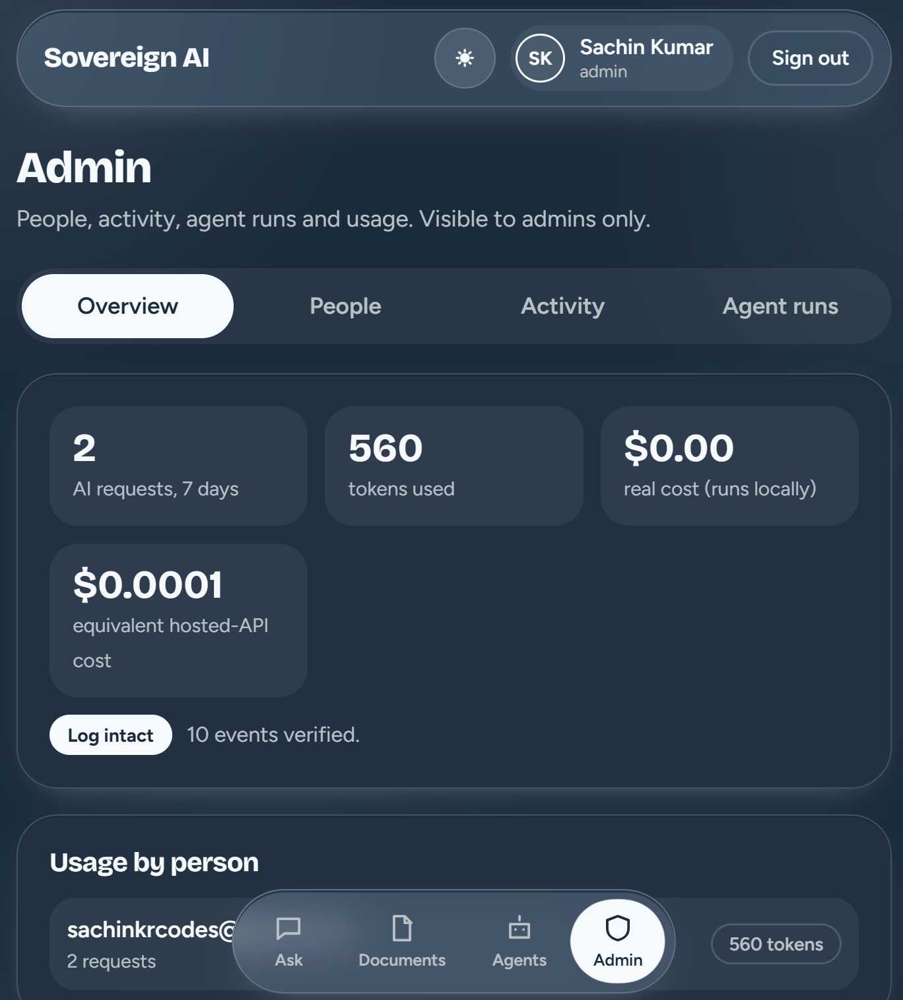

# Sovereign AI Workbench

Document question answering that runs on your own computer, for teams that cannot send confidential files to an online AI service.

- **Status:** in progress
- **Live:** Not live. Runs on my laptop.
- **Built:** November 2026
- **Keywords:** Python, FastAPI, React, Ollama, Llama 3.2, RAG, hybrid search, SQLAlchemy, SQLite, pytest, Docker, GitHub Actions

## Highlights

- Built a service where you upload PDF, Word or text files, ask a question, and get an answer with the file name and page numbers.
- Ran the language model (Llama 3.2 3B) and the embedding model (nomic-embed-text) on the laptop through Ollama, so no document text goes to an outside service.
- Combined BM25 keyword ranking with vector similarity using reciprocal rank fusion. Keyword search still works when Ollama is off.
- Added three agents, each with its own tool list and step limit: Librarian (lists the documents), Researcher (searches and answers with citations), Analyst (reads whole documents, compares them and does calculations).
- Added three roles (viewer, analyst, admin) and an audit log where each row holds the hash of the previous row. A verify endpoint reports the first edited or deleted row.
- Added a first-run screen that creates the admin account in the app.
- Added a Load sample documents button that uploads and indexes three fictional PDFs (a pump station procedure in two versions and an emergency plan).
- Tested with 144 pytest tests, all passing in 11.97 s (`python -m pytest -q` on Windows 11 with Python 3.13). GitHub Actions runs them on every push.
- Measured retrieval on 20 sample questions about 2 fictional documents (5 passages): the right file and page ranked first for 20 of 20.
- Measured answers from Llama 3.2 3B on the same questions: 20 of 20 correct with at least one citation, and 2 of 2 out-of-scope questions refused.
- Measured a median of 8.9 s per answer (slowest 10.9 s) on one Windows 11 laptop. The full table is in `backend/eval/results.md`.

## Screenshots


Answer to "Which valve is closed first before maintenance?" with the file and page it came from.


Researcher agent answering a question about the sample procedure.



Admin page with usage numbers and the audit log check.

## Tech

- Python and FastAPI: the backend API.
- SQLite and SQLAlchemy: users, documents, passages, vectors and the audit log. Postgres also works.
- Ollama with Llama 3.2 3B and nomic-embed-text: runs both models locally.
- NumPy: compares vectors in memory.
- React 18 and Vite: the web app.
- pytest and GitHub Actions: tests, web build and Docker image builds on every push.

## Run it

- Needs: Python 3.12 or newer, Node 20, Ollama
- Tested on: Windows 11 from a fresh clone, with Python 3.13. GitHub Actions uses Python 3.12 and Node 20 on Ubuntu.

```bash
ollama pull nomic-embed-text
ollama pull llama3.2:3b
git clone https://github.com/sachinkrcodes/sovereign-ai-workbench.git
cd sovereign-ai-workbench/backend
python -m venv .venv
.venv\Scripts\activate
pip install -r requirements-dev.txt
uvicorn app.main:app --reload
```

In a second terminal:

```bash
cd sovereign-ai-workbench/web
npm install
npm run dev
```

Open `http://localhost:5173`, create the admin account, then click Load sample documents on the Documents page. The sample files are fictional and live in `web/public/samples`.

To score the system on 20 sample questions, keep Ollama running and run `python -m eval.run_eval --answers` in `backend`. It writes `backend/eval/results.md`.

## Hardest problem

- Problem: the Researcher agent answered "I could not find this in the uploaded documents" even though its own search had returned the right passage.
- Tried: a stricter prompt about when to say "not found". The 3B model refused more often.
- Fixed by: a check in code. If the answer is "not found" but passages were retrieved, one more call answers from those passages, and the run records it as a step.
- Learned: a small model does not reliably follow a stricter prompt, so the check has to be in code.

## Limits and next

- Not done: scanned PDFs are rejected because there is no OCR.
- Not done: not deployed to a server.
- Not done: the accuracy script uses 20 questions on 5 passages. It shows the pipeline works but says little about large document sets.
- Not done: no load test. Vector search runs in memory, which suits thousands of passages.
- Not done: the Researcher returned a raw tool call instead of an answer once during testing, on the task "About her".
- Next: test on a larger real document set, then move vector search to pgvector.

## Author

Sachin Kumar | [GitHub](https://github.com/sachinkrcodes) | [LinkedIn](https://www.linkedin.com/in/sachinkrcodes) | sachinkrcodes@gmail.com

MIT License. See [LICENSE](LICENSE).
